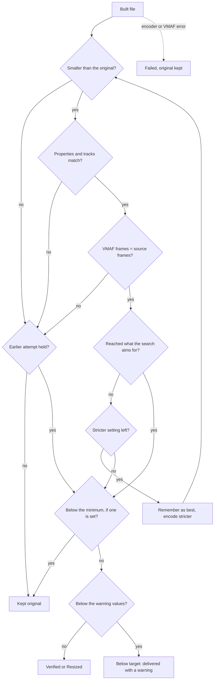

# Quality measurement

ClipShrink judges every conversion with **VMAF**, a score that compares the converted video with the original frame by frame. This page explains what is measured, when, and what happens when the score is too low.

!!! note "How the quality target works"
    A conversion is **recommended** when its VMAF **average is at least 95** and its **worst 1% of frames score at least 90**. Both are measured on every frame of the finished file. Test encodes on samples must clear both numbers by a further **0.5 points** (95.5 and 90.5). For 4K, the lower of two models' scores counts.

These are the default values. [Advanced settings](../user-guide/advanced-settings.md) can change them: the warning values, whether the search aims for them, and an optional minimum. The search aims for 95 and 90 unless the aim box is ticked.

## What is measured

- **Average:** the arithmetic mean of the per-frame scores.
- **Worst 1%:** the 1st percentile of the per-frame scores, linearly interpolated. It is a floor for the bad moments, not the mean of the worst frames.
- **Models:** `vmaf_v0.6.1` always. If the video is 2560 pixels or more in width or height, `vmaf_4k_v0.6.1` is also run, and the lower average and the lower worst 1% each count. Both models are built into FFmpeg.

## With a smaller size chosen

If **Largest size** in Settings shrinks a video, the reference is shrunk to the same size with the same scaler before VMAF runs, on both the samples and the finished file. The score therefore measures the encoding only. The file is labelled Resized rather than Verified, and the original's extra detail isn't counted. The larger 4K model is used according to the shrunken size.

## Two measurements

| Stage | What is scored | Margin |
|---|---|---|
| Quality search | Up to 3 sample pieces of 4 seconds each (the whole file if it is 18 seconds or shorter) | 0.5 |
| Final check | Every frame of the finished file, no sampling | 0 |

The search tries the 9 quality settings of the chosen encoder by binary search, or 16 when aiming for your own values, which adds looser and stricter ones. It takes the loosest (smallest-file) setting for which all samples meet the target plus the margin. If the previous file of the same resolution and frame rate used a setting, that one is tried first. If no setting passes, the strictest one is used.

## The decision

In words:

- **Verified:** everything matches and both numbers meet the target.
- **Resized:** the same as Verified, for a video shrunk as chosen in Settings. The numbers compare it with a copy of the original at the same size.
- **Below target:** everything matches and the file is smaller, but the score misses the target even at the strictest setting. The file is delivered with a warning sign. There is no lower limit unless you set a minimum.
- **Kept original:** the score was below a minimum you set, the video was not H.264, the result was not smaller, the result did not match the original, or VMAF did not compare the same number of frames as the source has. Nothing is delivered.
- **Failed:** an error stopped the file (for example the encoder stopped, VMAF could not run, or the original changed during conversion). The original is kept.

### Details worth knowing

- The "smaller" check runs before the VMAF check. A file that is both bigger and low quality is refused, never warned about.
- If a stricter retry turns out not to be smaller or not to match, the earlier below-target attempt is delivered with its warning.
- The "best" attempt is the most recent (strictest) one, not the highest-scoring one.
- "Properties and tracks match" covers: HEVC codec, resolution, pixel format, colour range, audio codec list, timing, and video packet count. Timing is the span from the first video packet's time to the last's, which must match within half a frame. The container's duration isn't used, because an encoder's start delay (edit list) can shift it although every frame keeps its time. For `.mp4`, `.mov`, `.m4v` and `.lrv` it also compares the other tracks and camera info; see [GoPro data](gopro-data.md).
- The estimate's "Meets the quality target?" column uses the warning values without the 0.5 margin.

## Measured example

Measured by the project author on one real 26-second 1080p clip of 101.4 MB (from the original How it works page); not reproduced by the automated tests:

| Encoder | Size | VMAF average | Worst 1% | Time |
|---|---|---|---|---|
| NVENC | 25.9 MB | 96.3 | 91.3 | 81 s |
| x265 | 34.2 MB | 96.7 | 90.4 | 152 s |

## Next steps

- [What the warnings mean](../user-guide/warnings.md)
- [How the estimate is made](estimation.md)
