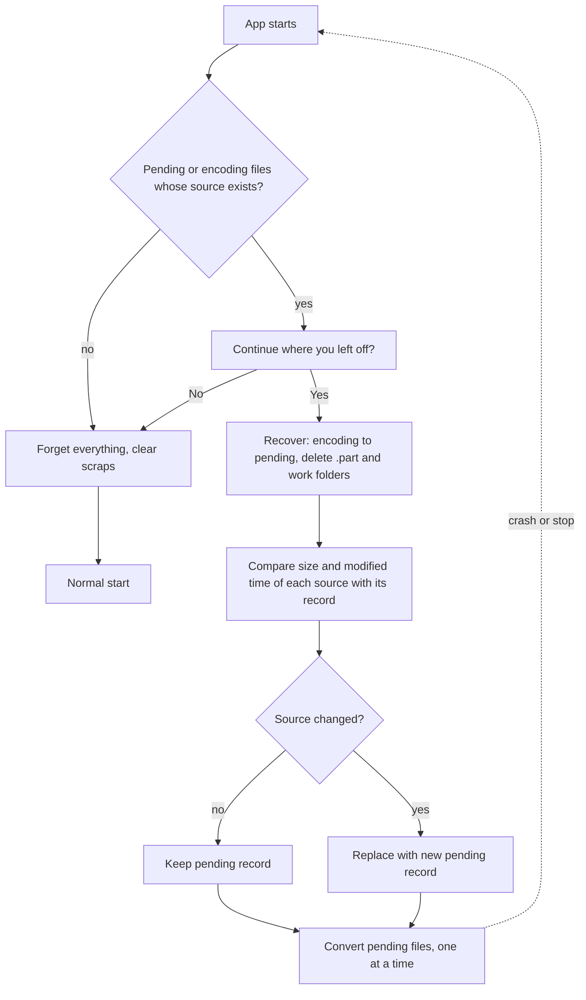

# Pause, resume and crash recovery

ClipShrink saves every state change to a small database before work moves on, so pausing, stopping and crashing are all safe for finished files.

## Pause

Pause is held in memory only. While FFmpeg is running, pausing suspends the FFmpeg process in place (Windows `NtSuspendProcess`), so no progress is lost. During the steps that run inside ClipShrink itself (hashing, the final copy, building the MP4), pause takes effect at the next checkpoint instead. Closing the app while paused does not keep the paused state.

## Stop

Closing the window while converting asks "Stop converting?". If you confirm, the current file goes back to `pending`, its temporary files are removed, and finished files are kept. A stopped run keeps the batch report as it stood after the last finished file; the stopped file is not added to it.

## Crash recovery

FFmpeg runs inside a Windows Job Object that kills it if ClipShrink dies, so no encoder is left running. The next time a conversion starts, recovery does three things: records marked `encoding` go back to `pending`, the `.part` file beside the original is deleted, and every `work\job_*` folder is deleted. The interrupted file restarts from the beginning; no half-finished encode is reused.

In the app, shortly after launch it looks for records that are `pending` or `encoding` whose source still exists. If it finds any, it asks "Continue where you left off?". Nothing resumes without a Yes. If you decline, ClipShrink forgets the batch and clears its scraps.

## When files are forgotten

Remembered status goes stale the moment someone changes files outside the app, so ClipShrink keeps as little as it can. All file status is dropped when:

- you exit with no unfinished batch;
- you click **Start Over**;
- you decline "Continue where you left off?";
- the app starts and finds no unfinished batch, for example after a crash on step 4.

An unfinished batch is the one thing kept, so crash recovery works. Reports are separate and always stay.

Whether a file is already done is decided from the folder. A scan treats an H.264 file as "Already has a conversion" if a real H.265 or AV1 file sits beside it with the same name and a tag such as `_(h265)`, `_(1080p)_(h265)`, `_(h265)_2` or the older `_H265`. A name alone isn't enough, because the file's format is checked too.

## The state database

The file is `%LOCALAPPDATA%\ClipShrink\state.db`, a SQLite database in WAL mode with full synchronous writes. It has one table, `files`, keyed by the source path (case-insensitive), with the status, reason, size and modified time of the source and the output, the output's SHA-256, both VMAF values, the encoder, the quality setting, the number of encodes, the format, both sizes, the duration, the values it was judged by, and when its conversion started and finished. Older databases gain these columns automatically.

| Status | Shown as |
|---|---|
| `pending` | Waiting |
| `encoding` | Working… |
| `verified` | Verified |
| `below_bar` | Below target (with a warning sign) |
| `kept_original` | Original kept |
| `failed` | Failed, original kept |
| `original_deleted` | Original in Recycle Bin |

A `verified` conversion at a smaller size is shown as "Resized", and one judged by other values shows them, as in "Verified at 90 / 85". That is worked out from its stored sizes, so it isn't a separate status.

"Done, has the original's name" is shown for a deleted original whose conversion was renamed; it is a display state, not a stored one.

When you add files that are already in the database, a file counts as unchanged when its size and modified time match the record. Conversions that are verified or below target are kept only while the output file still exists with the recorded size and time.

## Files that are not retried

`kept_original` and `failed` files with an unchanged source stay as they are while their batch is remembered. Once it is forgotten, a new scan offers them again. Only `pending` files are converted. If you change the original, it becomes a new pending record.

## Work and `.part` files

Encoder output is written under the work folder (`%LOCALAPPDATA%\ClipShrink\work` in the app). The one partial file beside the original is `<name>_(h265)<ext>.part` (or `_(av1)`, with a size tag if it was shrunk), written during the final copy and renamed when complete.

## Next steps

- [Continuing a batch in the app](../user-guide/converting.md)
- [How your files stay safe](safety.md)
