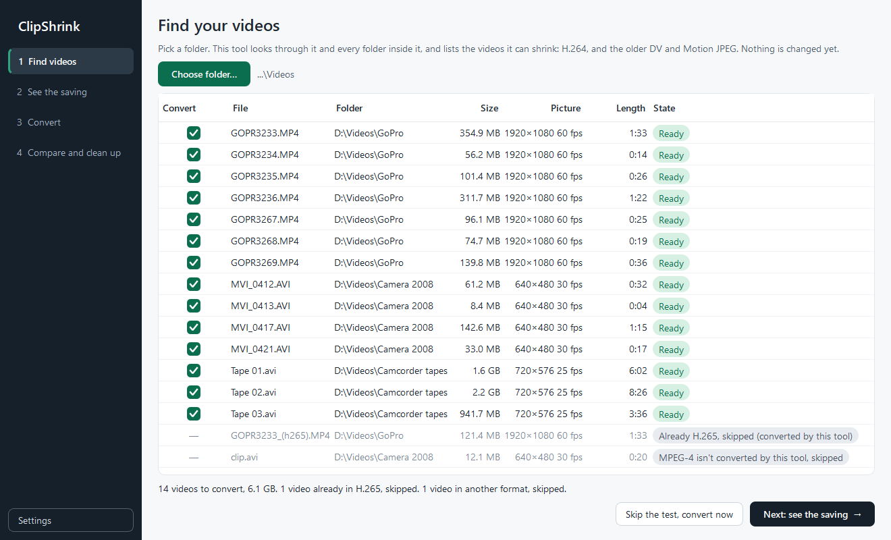

# Finding videos

Step 1 lists the videos ClipShrink can shrink. Nothing is changed yet.

## Choose a folder

Click **Choose folder…**. ClipShrink looks through that folder and every folder inside it, reading each video to find out its format. While it works you see "Reading your videos…".

It reads these file types, whatever the capitalisation: `.mp4`, `.mov`, `.m4v`, `.mkv`, `.avi`, `.lrv`, `.mts`, `.m2ts`, `.ts`, `.3gp` and `.dv`. Other files, such as photos or text files, are ignored and not listed. Symbolic links are not followed.

These folders are never entered: `$RECYCLE.BIN`, `System Volume Information`, `.tmp.drivedownload` and `.tmp.driveupload`. A folder Windows will not let ClipShrink open is skipped without a message.

## What the list shows

| Column | Meaning |
| --- | --- |
| Convert | Tick box. Click anywhere in the cell to toggle it. |
| File | File name |
| Folder | Where it lives |
| Size | File size |
| Picture | Resolution and frame rate, for example `1920×1080 30 fps` |
| Length | Duration as `m:ss` |
| State | `Ready`, or why the file is treated differently |

Click a column title to sort. The list keeps its original order until you do, and sizes sort by real size (900 MB comes before 1.2 GB).

## What is ticked, unticked or skipped

H.264 videos can be converted, and so can two older camera formats, DV and Motion JPEG (see [Older camera formats](#older-camera-formats-dv-and-motion-jpeg)). Most are ticked for you.

| What you see in State | Ticked? | Why |
| --- | --- | --- |
| `Ready` | Yes | H.264, DV or Motion JPEG video not converted before |
| `GoPro low-res preview, off by default` | No | `.lrv` files are GoPro's low-resolution preview versions of clips. Tick them only if you want them shrunk too. See [GoPro LRV files](#gopro-lrv-files). |
| `Already has a conversion` | No | A real H.265 or AV1 file with this name and a tag such as `_(h265)` is beside it, so it is not queued again by default. Tick it to convert it again. |
| `Verified`, `Original kept` and others | Depends | A result from the batch you're working on, until you exit or click **Start Over**. Verified files are not ticked. |
| `Already H.265, skipped` | Cannot be ticked | The video is already H.265. AV1 and other formats say so the same way. |
| `Already VP9, skipped` | Cannot be ticked | VP9 is efficient already, like H.265 and AV1. |
| `<format> isn't converted by this tool, skipped` | Cannot be ticked | Any other format, for example MPEG-4 (DivX, Xvid) or MPEG-2. |

ClipShrink decides all this from the files in the folder, with no memory of earlier sessions. So if you restore an H.264 original over its conversion, it simply shows as `Ready`.

Skipped rows are greyed and show a dash instead of a tick box. If a skipped file is a conversion ClipShrink made earlier, the State ends with "(converted by this tool)". That is why your own `_(h265)` files show up as already H.265 and are not converted a second time.

Files that cannot be read at all are not listed as rows. They are counted in the note under the list, with the first three names.

That note sums things up: how many videos there are to convert and how much space they take, how many are already H.265, and how many are in another format. If nothing convertible is found, it says so.

## Choose what to convert

Tick or untick any rows you like. Then pick one of two buttons, both disabled until at least one video is ticked:

- **Next: see the saving →** runs test encodes first and tells you how much space you'd save and how long it should take. See [See the saving](estimates.md).
- **Skip the test, convert now** goes straight to [Converting](converting.md). The conversion and every check are the same; you just don't get a saving or time measured beforehand. Useful when you already trust the result, for example on a second folder of the same footage.

!!! note
    ClipShrink does not skip small files. Any readable video it can convert is a candidate, whatever its size.

## Older camera formats: DV and Motion JPEG

Camcorders and compact cameras from about 1995 to 2010 often recorded in **DV** (tape camcorders, `.avi` or `.dv` files at 720×576 or 720×480) or **Motion JPEG** (many Canon, Nikon, Olympus and Fujifilm cameras, `.avi` or `.mov` files). Both store every frame as a separate picture, so the files are very large. Converted to H.265 they usually take about a sixth of the space or less.

They're converted with the same quality target and checks as H.264, with these differences:

- **DV is deinterlaced.** DV records two half-pictures (fields) per frame, which show as comb-like lines on a computer or a modern TV. Each field becomes a full frame, so a 25 fps DV video becomes 50 fps and motion stays as smooth as on the original TV. VMAF compares the conversion with the original deinterlaced the same way, so the score measures the encoding only. Motion JPEG is deinterlaced only if the file says it's interlaced; camera files almost never are. The same applies to interlaced HD from camcorders (1080i, often `.MTS` files from about 2006 to 2012): it becomes 50 fps. Those files are often compact already, so at the quality target the conversion isn't always smaller, and then the original is kept.
- **Colour is stored the standard way.** The conversion is 8-bit 4:2:0 at limited range, like nearly all video, whatever the original used. Colours and brightness look the same.
- **`.avi` and `.dv` files become `.mkv`**, because MP4 can't hold their uncompressed sound. `.mov` files stay `.mov`. The sound is copied unchanged.

## Next steps

- [See the saving](estimates.md) before you convert anything.

## GoPro LRV files

An LRV file is a small, low-resolution copy that a GoPro records alongside each video, so the camera and its phone app can show quick previews. You don't need it if you have the original video.

When a scan finds LRV files with their original video beside them, a pop-up tells you how many there are and how much space they take, and asks whether to send them to the Recycle Bin:

- **Yes** sends them to the Recycle Bin and removes them from the list. Each one is checked again just before it goes.
- **No** changes nothing. They stay on the list, unticked.

A preview counts as having its original if a video of the same name is in the same folder: `GL010123.LRV` goes with `GH010123` or `GX010123`, and `GOPR0123.LRV` with `GOPR0123`. A conversion of that video, such as `GX010123_(h265).mp4`, also counts. An LRV file with no such video beside it is always kept, and if there are only files like that, no pop-up appears.
